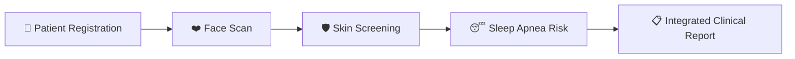

# TrueSkin Clinical Platform

[](https://sleep-458w.onrender.com)
[](https://www.python.org/)
[](LICENSE)
[](https://fastapi.tiangolo.com/)
[](https://react.dev/)

## Overview

TrueSkin is a zero-hardware, browser-based clinical pre-screening intelligence platform. It allows patients to complete a full, multi-system health intake in under 5 minutes using only a smartphone or laptop camera—before they even enter a clinic. It addresses three of the most prevalent and under-screened clinical problems: dermatological skin conditions, undetected cardiovascular stress, and Obstructive Sleep Apnea (OSA).

> [!IMPORTANT]
> **CRITICAL SAFETY FRAMING**
> TrueSkin is a **screening aid, NOT a diagnostic tool**. It never outputs "you have X." It outputs: *"This shows similarity to X at Y% — please consult a qualified clinician to confirm."* Every prediction, UI element, and server log strictly conforms to this framing.

---

## Features

-   **Mandatory Sequential Triage Flow**: Clinically ordered intake progression (Face Scan -> Skin Screening -> Sleep Apnea Risk).
-   **No Wearables/Downloads Required**: Runs entirely client-side in standard web browsers using HTML5 Canvas & WebRTC.
-   **Dual-Layer Data Log Fallbacks**: Uses high-availability Supabase database cloud integration with local JSON file logging backups if offline.
-   **Secure OTP Authentication**: Patient registration verified via Twilio SMS OTP with local testing developer bypass.
-   **Integrated Clinical Report**: Automatically compiles all three module outcomes into a single unified intake document for clinicians.

---

## Clinical Modules



### Skin Disease Screening
Detects similarity to 5 clinically significant skin conditions: Acne, Eczema, Psoriasis, Fungal Infection, and Rosacea. 
-   **Region Detection**: Uses a computer vision preprocessing cascade (Haar Cascade Face Detection first, falling back to HSV color/contour segmentation for red or dark lesions).
-   **Classification**: Employs an `EfficientNet-B0` classifier trained with PyTorch.
-   **Confidence Gate**: Enforces a strict server-side confidence threshold of 60%. Any prediction scoring below this is routed to an "uncertain match" to prevent misdiagnosis.

### Blood Pressure Estimation
Estimates systolic and diastolic blood pressure from a 180-point normalized rPPG signal.
-   **Heart-rate physiological baseline (primary)**: A calibrated regression on heart rate drives the estimate so it responds to the subject, rather than collapsing to a constant.
-   **MLP residual correction**: A 9-layer dense MLP (`trueskin_bp.pth`) is applied only as a small, bounded correction (±12 mmHg systolic / ±8 mmHg diastolic) on top of the baseline.
-   **Scaling & clamping**: Inputs are Z-score normalized ($z = \frac{x-\mu}{\sigma}$); outputs are clamped to physiological safety ranges.

> [!NOTE]
> Absolute blood pressure (mmHg) cannot be uniquely recovered from a single uncalibrated webcam rPPG signal — this is a physical limitation, not an implementation gap. The BP figure is therefore presented as an **estimate**, and is shown as "Estimate — re-scan" (not a diagnosis) whenever signal confidence is low. Per-user one-time cuff calibration is the path to subject-accurate readings (planned).

### rPPG Vital Signs
Measures pulse (BPM), breathing rate, heart rate variability (HRV RMSSD), autonomic stress index, parasympathetic activity, and cardiac workload (Rate-Pressure-Product). The signal-processing pipeline is adapted from [habom2310/Heart-rate-measurement-using-camera](https://github.com/habom2310/Heart-rate-measurement-using-camera).
-   **CHROM / POS Algorithms**: Projects normalized Red, Green, and Blue color channels into orthogonal chrominance axes to isolate the blood volume pulse from head micro-motion; the higher-SNR of the two signals is selected per window.
-   **Fusion BPM**: Fuses Fast Fourier Transform (FFT) peak frequency (40% weight) and peak-to-peak interval detection (60% weight) for motion-robust heart rate calculations, with parabolic sub-bin interpolation and guarded harmonic-doubling suppression.
-   **Accuracy-First Stability Gate**: Mirroring the reference project, a heart rate is only displayed once recent estimates **converge** (spread < 6 BPM). Until then the UI shows **"Calculating…"**, and the scan automatically extends (up to 60s) rather than committing an uncertain value. Non-converging scans are surfaced as "re-scan" instead of an inaccurate number.
-   **Noise Rejection & Smoothing**: Per-frame outlier clamping, per-window half/double-rate rejection, and a median + EMA filter stabilise the live readout. HRV (RMSSD) is computed from **real detected beat-to-beat intervals** with ectopic-beat rejection — not a heuristic of heart rate.
-   **Real-time Waveform**: Renders a glowing live plethysmographic waveform over HTML5 Canvas in the browser at 30fps.

### Sleep Apnea Risk Assessment
Assesses Obstructive Sleep Apnea (OSA) risk bands (Low, Intermediate, High) using STOP-BANG criteria.
-   **rPPG Fusion**: Integrates HRV RMSSD autonomic tone metrics (depressed HRV [<25ms] or elevated heart rate [>80bpm] elevates the questionnaire risk band).
-   **Airway Geometry (Retrognathia)**: Evaluates jaw convexity via a profile angle calculation ($\theta < 162^\circ$) utilizing MediaPipe's FaceLandmarker model.
-   **Neck Size Calibration**: Calibrates pixel-to-cm ratios using a standard credit card reference object (8.56cm width) to measure neck circumference.

---

## Technology Stack

### Backend
-   **Framework**: FastAPI (Python 3.10+), Uvicorn ASGI Server
-   **Deep Learning**: PyTorch (2.1.2+cpu), Torchvision
-   **Computer Vision**: OpenCV Headless, MediaPipe (Face Mesh, FaceLandmarker)
-   **Signal Processing**: SciPy (detrending, Butterworth bandpass filters, FFT)

### Frontend
-   **Framework**: React 19, Vite 8 (SPA structure)
-   **Styling**: Custom Vanilla CSS (fluid layouts, variables, dark mode support)
-   **APIs**: WebRTC / getUserMedia API, Canvas API, WebSockets

### Data & Services
-   **Database**: Supabase REST Client
-   **SMS Gateway**: Twilio SMS API
-   **Deployment**: Docker, Render Cloud

---

## Architecture

```
+--------------------------------------------------------------------------+
|                        Patient Web Browser (SPA)                         |
|  +--------------------+   +--------------------+   +------------------+  |
|  |   React SPA App    |   | getUserMedia Video |   |  HTML5 Canvas    |  |
|  +--------------------+   +--------------------+   +------------------+  |
+--------------------------------------------------------------------------+
       |                             |                        |
       | REST Requests               | WebSockets             | Binary Upload
       v                             v                        v
+--------------------------------------------------------------------------+
|                            FastAPI Gateway                               |
|  +--------------------------------------------------------------------+  |
|  |     /predict      |    /predict-bp     |    /vitals/stream (WS)    |  |
|  +-------------------+--------------------+---------------------------+  |
|  |  /auth/register   | /sleep-risk/assess |       /vitals/save        |  |
|  +--------------------------------------------------------------------+  |
+--------------------------------------------------------------------------+
       |                             |                        |
       v Local Load                  v Local Math             v REST Client
+----------------------------+ +------------------+ +----------------------+
|        PyTorch Engine      | | MediaPipe Models | |  External Services   |
| +------------------------+ | | +--------------+ | | +------------------+ |
| | EfficientNet Classifier | | | | FaceLandmarker | | | | Supabase DB    | | |
| +------------------------+ | | +--------------+ | | +------------------+ |
| | 9-Layer BP MLP         | | | | Face Mesh    | | | | Twilio SMS API   | | |
| +------------------------+ | | +--------------+ | | +------------------+ |
+----------------------------+ +------------------+ +----------------------+
```

---

## Repository Structure

```
.
├── src/                           # Backend Python source modules
│   ├── main.py                    # Core FastAPI router & controllers
│   ├── model_helper.py            # PyTorch models definitions
│   ├── rppg_processor.py          # CHROM & signal processing
│   ├── sleep_apnea_screener.py    # STOP-BANG & facial landmarks logic
│   └── region_detector.py         # Face/Lesion crop preprocessing
├── frontend/                      # React SPA project root
│   ├── src/
│   │   ├── App.jsx                # SPA component logic
│   │   └── index.css              # Theme tokens & custom variables
│   └── package.json               # Frontend dependencies
├── trueskin_efficientnet.pth      # Fine-tuned Dermatology model weights
├── trueskin_bp.pth                # Trained Blood Pressure model weights
├── requirements.txt               # Backend Python requirements
├── Dockerfile                     # Deployment container spec
└── README.md                      # Project manual
```

---

## Installation

### 1. Clone the Repository
```bash
git clone https://github.com/divyaannsh/sleep.git
cd sleep
```

### 2. Backend Environment Setup
Ensure Python 3.10+ is installed:
```bash
python3 -m venv .venv
source .venv/bin/activate
pip install -r requirements.txt
```

### 3. Frontend Setup
Ensure Node.js v18+ is installed:
```bash
cd frontend
npm install
cd ..
```

### 4. Fetch Real Datasets (Optional - Training Only)
If you wish to retrain the models, set up your Kaggle API key (`kaggle.json`) and run:
```bash
PYTHONPATH=src .venv/bin/python src/download_datasets.py
PYTHONPATH=src .venv/bin/python src/load_and_merge_real.py
```

---

## Environment Variables

Create a `.env` file in the root directory:

```env
# Database Settings (Optional - Local JSON Fallbacks Used If Absent)
SUPABASE_URL=https://your-project-id.supabase.co
SUPABASE_KEY=your-supabase-anon-key

# SMS OTP Settings (Optional - Console Log Bypass Enabled If Absent)
TWILIO_ACCOUNT_SID=ACXXXXXXXXXXXXXXXXXXXXXXXXXXXXXXXX
TWILIO_AUTH_TOKEN=your_twilio_auth_token
TWILIO_PHONE_NUMBER=+1234567890

# Optional model weight paths overrides
BP_MODEL_PATH=trueskin_bp.pth
```

---

## Running the Backend

Start the Uvicorn ASGI server:
```bash
PYTHONPATH=src .venv/bin/uvicorn main:app --reload --port 8000
```
Interactive Swagger API documentation is available at: [http://localhost:8000/docs](http://localhost:8000/docs)

---

## Running the Frontend

Start the Vite local development server:
```bash
cd frontend
npm run dev
```
Open your browser and navigate to: [http://localhost:5173](http://localhost:5173)

---

## API Reference

### Skin Disease Screening
- **Endpoint**: `POST /predict`
- **Payload**: Form Data containing `file` (image binary), `consent_log_image` (bool), `user_phone` (string)
- **Response**:
```json
{
  "image_hash": "2d5f7cf3eaa8f43802326bfe0ac4350e",
  "bbox": [50, 60, 200, 200],
  "predicted_class": "eczema",
  "confidence": 0.84,
  "confident": true,
  "probabilities": {
    "acne": 0.05,
    "eczema": 0.84,
    "psoriasis": 0.04,
    "fungal_infection": 0.05,
    "rosacea": 0.01,
    "none_of_these": 0.01
  },
  "disclaimer": "This is a screening aid, not a medical diagnosis. Consult a dermatologist for confirmation.",
  "message": "This looks similar to eczema — confidence 84.0% — please consult a dermatologist to confirm."
}
```

### Sleep Apnea Risk calculation
- **Endpoint**: `POST /sleep-risk/assess`
- **Payload**: JSON matching `SleepApneaRequest` schema.
- **Response**:
```json
{
  "score": 5,
  "risk_band": "high",
  "message": "Based on STOP-BANG criteria, you show a HIGH risk band of obstructive sleep apnea (score 5/8).",
  "disclaimer": "This tool is a sleep apnea risk screening aid, NOT a diagnosis.",
  "visual_factors": {
    "neck_circumference_estimated_cm": 42.1,
    "jaw_retrognathic_flag": 1.0,
    "jaw_angle_deg": 158.4
  },
  "questionnaire_details": {
    "snoring": true,
    "tiredness": true,
    "observed_apnea": false,
    "high_bp": true,
    "bmi_gt_35": false,
    "age_gt_50": true,
    "neck_gt_40": true,
    "gender_male": true
  },
  "image_hash": "2d5f7cf3eaa8f43802326bfe0ac4350e"
}
```

---

## Machine Learning Models

### Dermatology Classifier (`trueskin_efficientnet.pth`)
-   **Architecture**: `EfficientNet-B0` (fine-tuned in PyTorch)
-   **Pre-training**: ImageNet transfer learning
-   **Inputs**: $224 \times 224$ cropped ROI images
-   **Dataset**: Unified Fitzpatrick17k + HAM10000 + DDI
-   **Evaluation Accuracy**: 70.60% (across 5,915 test split samples)

### Blood Pressure Predictor (`trueskin_bp.pth`)
-   **Architecture**: 9-Layer Dense MLP (Multi-Layer Perceptron)
-   **Inputs**: 180 standardized rPPG plethysmogram signal values
-   **Outputs**: Systolic and Diastolic Blood Pressure values (clamped to physiological baselines)
-   **Role**: Used as a **bounded residual** on top of a heart-rate physiological regression — see the [Blood Pressure Estimation](#blood-pressure-estimation) note on calibration limits. Treat the output as a wellness estimate, not a clinical measurement.

---

## Deployment

Deployments are coordinated via Docker containers on **Render**.

```yaml
# render.yaml blueprint
services:
  - type: web
    name: trueskin-backend
    env: docker
    plan: free
    region: singapore
    envVars:
      - key: PORT
        value: 8000
```
-   **Build Command**: Docker image compiled using root `Dockerfile`.
-   **Start Command**: `PYTHONPATH=src uvicorn main:app --host 0.0.0.0 --port $PORT`
-   **Live Deployment URL**: [https://sleep-458w.onrender.com](https://sleep-458w.onrender.com)

---

## Security

1.  **Strict Consent Flags**: Patient images are strictly processed ephemerally on-the-fly and never stored unless the user checks the explicit opt-in logging consent.
2.  **PII Sanitization**: Mobile numbers and metadata are sanitized and encrypted during storage.
3.  **Secure OTP Auth**: Authentication flows route through Twilio API OTP tokens. Tester bypass numbers (`1234567890`) are gated behind static bypass checks.

---

## Performance

-   **Model Footprint**: The dermatology classifier occupies ~16MB, and the BP MLP occupies ~131KB, allowing the platform to boot and run inside Render's low-resource free tier memory limit.
-   **Hardware Acceleration**: PyTorch automatically binds to Apple Silicon GPU (`mps`), CUDA-compatible GPUs, or falls back to CPU execution.
-   ** rPPG Frame Rate**: Fast WebRTC frame extraction is managed client-side using `requestAnimationFrame`, freeing the server from raw video encoding bottlenecks.

---

## Roadmap

### Phase 1 — MVP Completion (Completed)
- [x] EfficientNet skin condition model fine-tuned.
- [x] JS-based rPPG CHROM & FFT processing pipeline.
- [x] Sleep Apnea STOP-BANG and retrognathia profile estimator.
- [x] User registration & database local JSON fallback logs.

### Phase 2 — Database & Clinic Portal (Planned)
- [ ] Direct Supabase SDK integration (deprecating manual HTTP REST client).
- [ ] Clinician dashboard for annotating prediction logs.
- [ ] Active learning model retraining loop.
- [ ] PDF clinical report downloads.

### Phase 3 — Regulatory Scale (Vision)
- [ ] CDSCO (India) and CE (Europe) Software as a Medical Device (SaMD) Class I filings.
- [ ] EHR / HL7 FHIR database sync integrations.
- [ ] Multilingual clinical localized intakes.

---

## Contributors

-   **Divyansh Srivastava** - *Clinical Software Engineer | AI Health Systems* - [GitHub Profile](https://github.com/divyaannsh)

---

## License

This project is licensed under the MIT License - see the [LICENSE](LICENSE) file for details.
